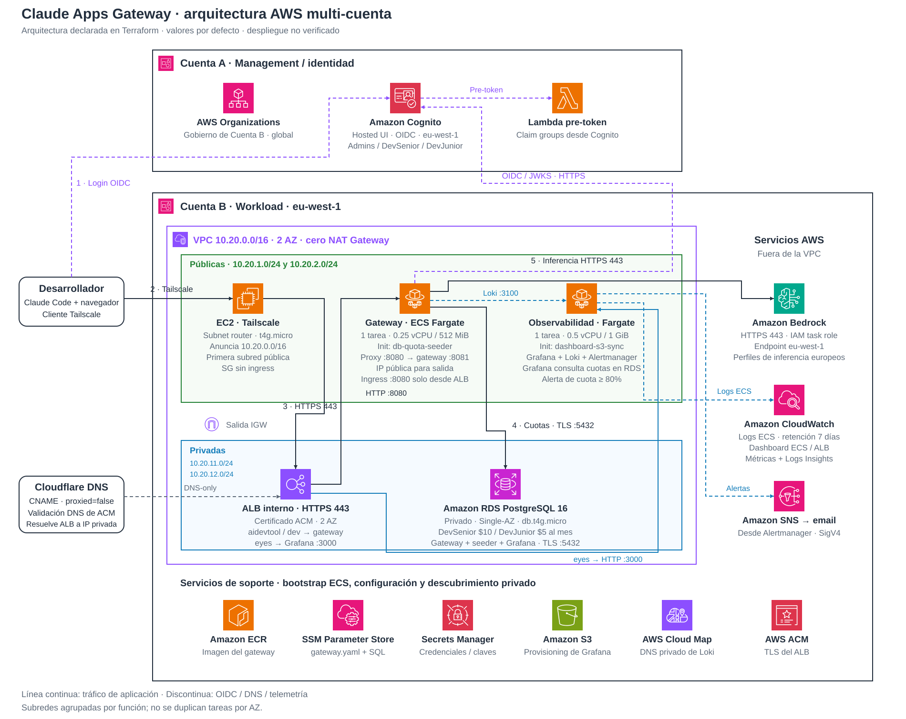
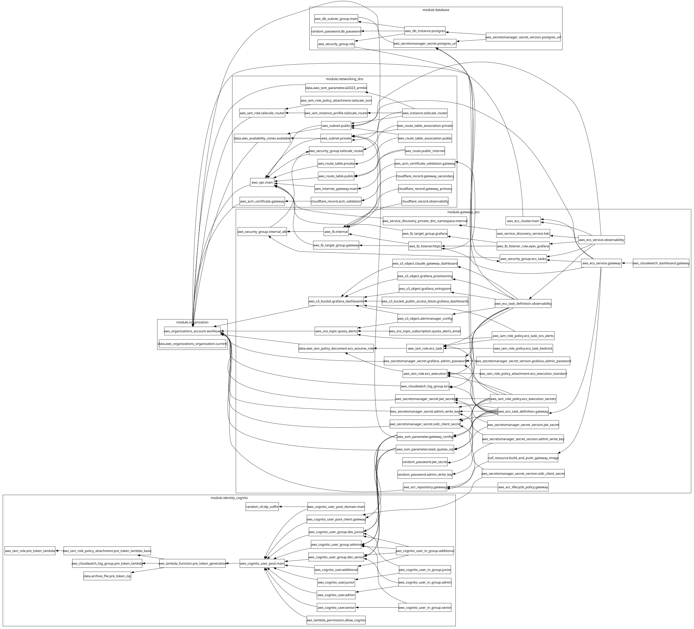

# Laboratorio Multi-Cuenta de Claude Apps Gateway en AWS (`claude-gateway-lab`)

Infraestructura como Código (100% **Terraform**) para desplegar el **Claude Apps Gateway for AWS** de Anthropic bajo una arquitectura **Multi-Cuenta real** en la región **`eu-west-1` (Irlanda)**, con autenticación federada OIDC en **Amazon Cognito**, control de gasto mensual por grupo en **RDS PostgreSQL** (**$10/mes** para `DevSenior` y **$5/mes** para `DevJunior`), acceso estrictamente privado mediante **Tailscale Subnet Router**, validación TLS con **Cloudflare DNS + AWS ACM** y **coste $0 en NAT Gateways**.

---

## 1. Arquitectura Multi-Cuenta y Flujo de Red / Autenticación

```text
+---------------------------------------------------------------------------------------------------+
|                                     PORTATIL DEL DESARROLLADOR                                    |
|  Claude Code CLI (`claude /login`) + Cliente Tailscale Activo (Aceptando ruta 10.20.0.0/16)       |
+------------------------------------+-------------------------------------+------------------------+
                                     |                                     |
       1. Login OIDC (HTTPS Publico) |                                     | 2. Inferencia / API Privada
          Cognito Hosted UI          |                                     |    https://aidevtool.midominio.com
                                     v                                     |    (CNAME en Cloudflare proxied=false
+-------------------------------------------------------------------+      |     -> IP Privada 10.20.11.x del ALB)
| CUENTA A: IDENTIDAD / MANAGEMENT (`aws.identity` - eu-west-1)     |      |
|                                                                   |      | Tunel WireGuard (Tailscale)
|  +-----------------------------+   +---------------------------+  |      |
|  | AWS Organizations           |   | Amazon Cognito User Pool  |  |      v
|  | - Crea/Gestiona Cuenta B    |   | - Grupos:                 |  |   +-------------------------------------------+
|  | - Rol: OrganizationAccount  |   |   * claude-gateway-admins |  |   | CUENTA B: WORKLOAD (`aws.workload`)       |
|  |   AccessRole                |   |   * DevSenior ($10/mes)   |  |   | VPC 10.20.0.0/16 (eu-west-1, Cero NAT GW) |
|  +-----------------------------+   |   * DevJunior ($5/mes)    |  |   |                                           |
|                                    | - Usuarios:               |  |   |  [Subredes Publicas 10.20.1.0/24, 2.0/24] |
|  +-----------------------------+   |   * senior@midominio.com  |  |   |  +-------------------------------------+  |
|  | Lambda Pre-Token Generation |<--+   * junior@midominio.com  |  |   |  | EC2 t4g.nano Tailscale Subnet Router|  |
|  | (Python) Inyecta claim      |   |   * admin@midominio.com   |  |   |  | Anuncia 10.20.0.0/16 (SG: 0 Inbound)|  |
|  | `groups` en el ID Token JWT |   +-------------+-------------+  |   |  +------------------+------------------+  |
|  +-----------------------------+                 ^                |   |                     | HTTPS 443           |
+--------------------------------------------------|----------------+   |                     v                     |
                                                   |                    |  [Subredes Privadas 10.20.11.0/24, 12/24] |
                                                   |                    |  +-------------------------------------+  |
                                                   |                    |  | ALB Interno (internal = true)       |  |
                                                   |                    |  | Certificado ACM validado Cloudflare |  |
                                                   |                    |  +------------------+------------------+  |
                                                   |                    |                     | HTTP 8080           |
                                                   |                    |                     v                     |
                                                   |                    |  [Subredes Publicas - Salida Directa IGW] |
                                                   | 3. Valida OIDC     |  +-------------------------------------+  |
                                                   +--------------------+--| ECS Fargate (256 CPU / 512 MB)      |  |
                                                     JWKS / Token       |  | assign_public_ip = true             |  |
                                                                        |  | SG: Solo acepta 8080 desde el ALB   |  |
                                                                        |  |  1) init: gateway-config-sync      |  |
                                                                        |  |  2) init: db-quota-seeder          |  |
                                                                        |  |  3) main: claude-gateway           |  |
                                                                        |  +---------+-----------------+---------+  |
                                                                        |            |                 |            |
                                                                        |  SQL 5432  |                 | HTTPS 443  |
                                                                        |            v                 v            |
                                                                        |  +------------------+ +----------------+  |
                                                                        |  | RDS PostgreSQL 16| | Amazon Bedrock |  |
                                                                        |  | db.t4g.micro     | | (eu-west-1)    |  |
                                                                        |  | Topes: $10 / $5  | | Claude Sonnet/ |  |
                                                                        |  +------------------+ | Opus / Haiku   |  |
                                                                        +-----------------------+----------------+--+
```



[Abrir a tamaño completo](media/architecture.svg) · [Editar en draw.io](media/architecture.drawio) · [Cómo editar y regenerar](media/README.md)

El diagrama representa la arquitectura declarada en Terraform y sus valores por defecto. Para regenerar el SVG y el archivo editable: `python3 scripts/generate_architecture.py`.

### Flujo Paso a Paso
1. **Resolución DNS y Enrutamiento Privado:** El desarrollador ejecuta `claude` en su portátil con el cliente **Tailscale** conectado. Al invocar `https://aidevtool.midominio.com`, Cloudflare devuelve un registro `CNAME` (`proxied = false`) que apunta al nombre DNS del **ALB Interno** de AWS (`internal-...eu-west-1.elb.amazonaws.com`), el cual resuelve a IPs privadas (`10.20.11.x` / `10.20.12.x`).
2. **Túnel Tailscale:** El portátil encamina automáticamente los paquetes dirigidos a `10.20.0.0/16` a través del nodo `aws-claude-gateway-router` (`t4g.nano` en la Cuenta B) hasta el puerto `443` del ALB Interno, presentando un certificado TLS público válido emitido por AWS ACM.
3. **Autenticación OIDC Multi-Cuenta:** Al ejecutar `claude /login`, el Gateway redirige al navegador hacia el Hosted UI de **Amazon Cognito en la Cuenta A**. Tras autenticarse, la función **Lambda Pre-Token Generation** inyecta los grupos del usuario (`cognito:groups` $\rightarrow$ `groups`: `["DevSenior"]` o `["DevJunior"]`) directamente en el ID Token OIDC.
4. **Control de Gasto Mensual (DB Seeding + Configuración Declarativa):** Terraform guarda `gateway.yaml` y `seed_quotas.sql` renderizados en el bucket S3 privado de configuración. Al arrancar ECS, `gateway-config-sync` descarga ambos archivos; después `db-quota-seeder` (`postgres:16-alpine`) ejecuta desde el archivo una transacción SQL idempotente (`ON CONFLICT DO UPDATE`) sobre RDS PostgreSQL que registra los límites mensuales de **$10.00 USD** (`1000` centavos) para `DevSenior` y **$5.00 USD** (`500` centavos) para `DevJunior`. El Gateway comienza cuando termina el seeding.
5. **Inferencia Segura en Amazon Bedrock:** Si el grupo del desarrollador no ha superado su presupuesto mensual, la tarea ECS Fargate asume su `task_role_arn` e invoca los perfiles de inferencia europeos (`eu.anthropic.claude-sonnet-4-6`, `eu.anthropic.claude-opus-4-6-v1`, `eu.anthropic.claude-haiku-4-5-20251001-v1:0`) en **Amazon Bedrock (`eu-west-1`)** sin que el portátil tenga jamás credenciales de AWS.

   > **Selector `/model` de Claude Code:** Claude Code CLI valida `availableModels` contra su catálogo canónico (`claude-sonnet-4-6`, `claude-opus-4-6`, `claude-haiku-4-5`). Los IDs de perfiles regionales con prefijo `eu.anthropic.*` no coinciden con la expresión regular del CLI y son omitidos del selector (Sonnet 4.6 solo aparecía porque estaba forzado en `model:` como modelo activo). En [config/gateway.yaml.tftpl](config/gateway.yaml.tftpl), el Gateway expone los nombres canónicos al CLI y los mapea internamente al upstream de Bedrock (`upstream_model: { bedrock: eu.anthropic... }`). Tras aplicar cambios con `terraform apply`, ejecuta `claude /login` en tu terminal para sincronizar las nuevas políticas gestionadas.

---

## 2. Decisiones de Ahorro de Costes y Destrucción Limpia

| Componente | Alternativa Tradicional | Diseño de este Laboratorio | Ahorro / Beneficio |
| :--- | :--- | :--- | :--- |
| **Salida a Internet de ECS** | 2x AWS NAT Gateway (~$65-$90/mes) | **Cero NAT Gateways**: Tareas ECS en subred pública con `assign_public_ip = true` y Security Group que **bloquea todo ingreso desde Internet** (solo acepta puerto `8080` desde el Security Group del ALB Interno). | **~$70/mes ahorrados** manteniendo aislamiento total de entrada. |
| **Acceso VPN Privado** | AWS Client VPN (~$75-$110/mes) | **Tailscale Subnet Router** sobre EC2 `t4g.nano` ARM64 (~$3/mes) sin puertos entrantes abiertos. | **~$80/mes ahorrados** y configuración en segundos. |
| **Certificados TLS** | ACM Private CA ($400/mes) | **AWS ACM Público Gratuito** validado mediante DNS en Cloudflare (`proxied = false`). | **$400/mes ahorrados** con TLS válido en navegadores y CLI. |
| **Base de Datos** | Aurora Serverless v2 (~$45/mes) | **RDS PostgreSQL 16 `db.t4g.micro`** Single-AZ (`20 GB gp3`). | Coste mínimo de laboratorio (~$12/mes o capa gratuita). |
| **Destrucción (`terraform destroy`)** | Fallos por snapshots, retención de secretos o imágenes ECR | `skip_final_snapshot = true`, `deletion_protection = false`, `recovery_window_in_days = 0` en Secrets Manager y `force_delete = true` en ECR. | **`terraform destroy` 100% limpio** a la primera sin recursos huérfanos. |

---

## 3. Prerrequisitos

1. **Bucket S3 para el Remote State en la Cuenta A (`eu-west-1`):**
   El archivo `versions.tf` está preconfigurado para usar el bucket `tu-bucket-terraform-state-unico`. Si aún no existe en tu Cuenta A, créalo antes de ejecutar `terraform init`:
   ```bash
   aws s3api create-bucket \
     --bucket tu-bucket-terraform-state-unico \
     --region eu-west-1 \
     --create-bucket-configuration LocationConstraint=eu-west-1

   aws s3api put-bucket-versioning \
     --bucket tu-bucket-terraform-state-unico \
     --versioning-configuration Status=Enabled
   ```
2. **AWS Organizations en la Cuenta A:**
   Tu Cuenta A debe ser la cuenta de administración (Management Account) de una Organización de AWS. Si prefieres usar una Cuenta B que ya forme parte de tu organización en lugar de crear una nueva, configura `create_workload_account = false` y `existing_workload_account_id = "123456789012"` en tu `terraform.tfvars`.
3. **Acceso a Modelos Anthropic Claude en Amazon Bedrock (`eu-west-1`):**
   En la **Cuenta B (Workload)**, verifica en la consola de **Amazon Bedrock (`eu-west-1`)** que el acceso a los modelos de Anthropic (`Claude Sonnet 4.6`, `Claude Opus 4.6`, `Claude Haiku 4.5`) esté habilitado.
4. **Cloudflare API Token y Zone ID:**
   - Un **API Token** de Cloudflare con permisos `Zone -> DNS -> Edit` sobre la zona de tu dominio (`midominio.com`).
   - El **Zone ID** de tu dominio (visible en la página principal del dominio en Cloudflare).
5. **Tailscale Auth Key:**
   - Genera una **Auth Key** (marcada como *Reusable* y opcionalmente *Ephemeral*) en [Tailscale Admin Console -> Settings -> Keys](https://login.tailscale.com/admin/settings/keys).
6. **Docker y AWS CLI instalados localmente:**
   - Necesarios para que durante `terraform apply` el recurso `null_resource.build_and_push_gateway_image` empaquete automáticamente el binario oficial de Linux de Anthropic (`claude gateway`) y suba la imagen al repositorio ECR de la Cuenta B.

---

## 3.1 Estructura del Repositorio y Construcción Automática de la Imagen Docker

Anthropic no publica una imagen precompilada en Docker Hub para el **Claude Apps Gateway**, ya que el servidor del Gateway está integrado directamente como subcomando nativo (`claude gateway --config /etc/claude/gateway.yaml`) dentro del binario oficial firmado de Linux distribuido en `https://downloads.claude.ai/claude-code-releases`.

Este repositorio **automatiza el ciclo completo de extremo a extremo** sin que necesites ninguna imagen previa:

1. **`docker/Dockerfile` (Multi-Stage `linux/amd64`):**
   - **Etapa 1 (`downloader`):** Descarga la versión solicitada (`latest` o fija mediante `claude_binary_version`) desde `https://downloads.claude.ai/claude-code-releases`, extrae el hash oficial desde `manifest.json` y **verifica criptográficamente el checksum SHA-256** del binario `claude` antes de instalarlo. Además descarga el bundle oficial de certificados CA de Amazon RDS (`rds-global-bundle.pem`).
   - **Etapa 2 (Runtime sin privilegios):** Crea un contenedor ligero `debian:bookworm-slim` con `python3` ejecutado bajo el usuario sin privilegios `65532:65532` (`gateway`), con `NODE_EXTRA_CA_CERTS=/etc/claude/rds-global-bundle.pem`.
2. **`docker/entrypoint.sh` y `docker/gateway_proxy_loki.py`:**
   - Copia el archivo descargado desde S3 en `/etc/claude/gateway.yaml` y asigna el puerto interno `8081` al proceso `claude gateway`, mientras `gateway_proxy_loki.py` escucha en `0.0.0.0:8080`, reenvía en streaming (SSE) hacia `127.0.0.1:8081`, captura los prompts de usuario en `POST /v1/messages` (`evt = "user.prompt"`) y envía todos los logs estructurados a **Loki** (`http://loki.claude-gateway-lab.internal:3100/loki/api/v1/push`).
3. **`scripts/build_and_push_gateway.sh` + `null_resource.build_and_push_gateway_image`:**
   - Durante `terraform apply`, inmediatamente después de crear `aws_ecr_repository.gateway` y **antes** de crear `aws_ecs_service.gateway`, Terraform ejecuta `scripts/build_and_push_gateway.sh`.
   - El script asume automáticamente el rol `OrganizationAccountAccessRole` hacia la **Cuenta B**, se autentica en el registro ECR de la Cuenta B, compila la imagen `linux/amd64` y hace `docker push <ecr_repository_url>:latest`.

```text
claude-gateway-lab/
├── versions.tf                        # Backend S3 (tu-bucket-terraform-state-unico) y providers
├── providers.tf                       # Providers AWS Multi-Cuenta (aws.identity y aws.workload) + Cloudflare
├── variables.tf                       # Variables globales parametrizadas
├── main.tf                            # Orquestacion de los 5 modulos
├── outputs.tf                         # Outputs de URLs, Cognito, ECR, RDS, Observabilidad e instrucciones CLI
├── terraform.tfvars.example           # Plantilla lista para copiar a terraform.tfvars
├── config/
│   ├── gateway.yaml.tftpl             # Configuracion declarativa estricta de `claude gateway`
│   └── seed_quotas.sql.tftpl          # Seed SQL idempotente (migraciones 1..6 + $10 DevSenior / $5 DevJunior)
├── docker/
│   ├── Dockerfile                     # Multi-stage build con verificacion SHA-256 del binario oficial `claude`
│   ├── entrypoint.sh                  # Copia /gateway-config/gateway.yaml -> /etc/claude/gateway.yaml
│   └── gateway_proxy_loki.py          # Proxy async :8080 -> :8081 que captura prompts (`user.prompt`) y envia a Loki
├── monitoring/
│   ├── README.md                      # Guia del stack de observabilidad (ECS Eyes + CloudWatch)
│   ├── alertmanager/
│   │   └── alertmanager.yml.tftpl     # Plantilla de configuracion de Alertmanager (SNS SigV4 email)
│   └── grafana/
│       ├── claude-gateway-dashboard.json # Dashboard de Grafana (Cuotas SQL + Prompts/Logs en Loki)
│       ├── entrypoint.sh              # Entrypoint desacoplado (parseo de Postgres URL + sync provisioning)
│       └── provisioning/              # Auto-provisioning nativo sincronizado via S3
│           ├── alerting/
│           │   └── quota_80_alert.yaml # Regla de alerta 80% cuota mensual hacia Alertmanager
│           ├── dashboards/
│           │   └── default.yaml       # Proveedor de dashboards JSON en /var/lib/grafana/dashboards
│           └── datasources/
│               └── all.yaml           # Datasources PostgreSQL (env vars), Loki y Alertmanager
├── scripts/
│   └── build_and_push_gateway.sh      # Script cross-account (sts:AssumeRole) para build & push a ECR (Cuenta B)
└── modules/
    ├── 01-organization/               # Creacion/vinculacion de Cuenta B en AWS Organizations (protegida ante destroy)
    ├── 02-identity-cognito/           # Cognito User Pool, Grupos, Usuarios y Lambda Pre-Token Generation
    ├── 03-networking-dns/             # VPC Cero-NAT, ACM TLS (aidevtool, dev, eyes), Cloudflare DNS y Tailscale EC2
    ├── 04-database/                   # RDS PostgreSQL 16 (db.t4g.micro) + Secrets Manager
    └── 05-gateway-ecs/                # ECR, ALB Interno, Gateway ECS, Observability ECS (Grafana+Loki+Alertmanager), S3 y CloudWatch
```

---

## 4. Guía de Despliegue Paso a Paso

### Paso 1: Configurar las variables del laboratorio
Copia la plantilla de ejemplo y rellena tus identificadores de Cloudflare, Tailscale y el correo de la Cuenta B:

```bash
cp terraform.tfvars.example terraform.tfvars
```

Edita `terraform.tfvars` con tus valores reales:
- `cloudflare_zone_id`
- `cloudflare_api_token`
- `tailscale_auth_key`
- `workload_account_email` (ej. `aws-workload@midominio.com`)

### Paso 2: Inicializar y desplegar con Terraform
Con tus credenciales de AWS de la **Cuenta A (Identidad / Management)** activas en tu terminal y el demonio de **Docker** en ejecución:

```bash
terraform init
terraform plan
terraform apply
```

> **¿Cómo funciona la subida de la imagen a ECR durante `terraform apply`?**
> - Con `auto_build_gateway_image = true` (valor por defecto), Terraform construirá y subirá automáticamente la imagen del Gateway al repositorio ECR de la Cuenta B antes de iniciar el servicio ECS Fargate.
> - Si en cualquier momento deseas reconstruir o actualizar manualmente la imagen (o si prefieres definir `auto_build_gateway_image = false`), puedes ejecutar el script directamente:
>   ```bash
>   ECR_REPOSITORY_URL="$(terraform output -raw ecr_repository_url)" \
>   WORKLOAD_ACCOUNT_ID="$(terraform output -raw workload_account_id)" \
>   ASSUME_ROLE_ARN="arn:aws:iam::$(terraform output -raw workload_account_id):role/OrganizationAccountAccessRole" \
>   ./scripts/build_and_push_gateway.sh
>   ```
> - Al iniciar la tarea en ECS Fargate, arrancará primero el contenedor `db-quota-seeder` (que siembra automáticamente los topes de **$10.00 USD** y **$5.00 USD** en RDS PostgreSQL) y a continuación levantará `claude-gateway`.

---

## 5. Aprobación de la Ruta Privada en Tailscale y Verificación DNS

Una vez completado `terraform apply`:

1. Abre la [Consola de Administración de Tailscale (Machines)](https://login.tailscale.com/admin/machines).
2. Busca la máquina **`aws-claude-gateway-router`**.
3. Haz clic en el menú **`...`** $\rightarrow$ **`Edit route settings`** y **aprueba la subred `10.20.0.0/16`**.
4. En tu portátil de desarrollo, asegúrate de estar conectado a tu Tailnet aceptando rutas anunciadas:
   ```bash
   sudo tailscale up --accept-routes
   ```
5. Verifica que el dominio resuelve a las IPs privadas del ALB Interno (`10.20.11.x` / `10.20.12.x`) y que responda el endpoint de salud y descubrimiento OAuth a través del túnel Tailscale (en terminal o abriendo estas URLs en tu navegador):
   ```bash
   dig +short aidevtool.midominio.com
   curl -i https://aidevtool.midominio.com/readyz
   curl -i https://aidevtool.midominio.com/.well-known/oauth-authorization-server
   ```

---

## 6. Configuración y Pruebas con Claude Code CLI (`DevSenior` vs `DevJunior`)

### 6.1 Configurar el Gateway de Login en tu portátil (`~/.claude/settings.json`)
Para que `claude /login` autentique contra el **Claude Apps Gateway** privado en lugar de redirigir a `claude.ai`, edita `~/.claude/settings.json` en tu máquina local y configura **`forceLoginMethod`** y **`forceLoginGatewayUrl`** (eliminando `ANTHROPIC_BASE_URL` de `"env"` si lo habías añadido antes):

```json
{
  "forceLoginMethod": "gateway",
  "forceLoginGatewayUrl": "https://aidevtool.midominio.com"
}
```

### 6.2 Iniciar sesión OIDC con `claude` y `/login`
Ejecuta en tu terminal:

```bash
claude
```

Dentro de la sesión interactiva de Claude Code, ejecuta:

```text
/login
```

Se abrirá tu navegador redirigiendo al **Hosted UI de Amazon Cognito (Cuenta A)**. Puedes probar los dos perfiles aprovisionados automáticamente por Terraform:

| Perfil | Email de Usuario en Cognito | Grupo OIDC Inyectado | Tope Mensual | Modelos Permitidos en Bedrock (`eu-west-1`) |
| :--- | :--- | :--- | :--- | :--- |
| **Desarrollador Senior** | `senior@midominio.com` | `DevSenior` | **$10.00 USD / mes** (`1000` cts) | Claude Sonnet 4.6, Claude Opus 4.6, Claude Haiku 4.5 |
| **Desarrollador Junior** | `junior@midominio.com` | `DevJunior` | **$5.00 USD / mes** (`500` cts) | Claude Sonnet 4.6, Claude Haiku 4.5 *(Opus bloqueado por política)* |
| **Administrador** | `admin@midominio.com` | `claude-gateway-admins` | **$100.00 USD / mes** | Acceso completo + Consola/API de Administración |

*(La contraseña inicial de todos los usuarios es el valor configurado en `initial_user_password` en tu `terraform.tfvars`).*

---

## 7. Observabilidad y Alertas (`https://eyes.midominio.com/`, Loki, Alertmanager y CloudWatch)

El proyecto despliega dos niveles complementarios de observabilidad en la **Cuenta B (Workload)**:

### 7.1 Stack en ECS Fargate (`Grafana` + `Loki` + `Alertmanager`)
- **Acceso privado por Tailscale (`https://eyes.midominio.com/`):**
  - Protegido con certificado ACM y CNAME privado en Cloudflare (`proxied = false`) hacia el mismo ALB Interno (enrutamiento Host-Header hacia el Target Group `:3000`). Solo es accesible cuando tienes Tailscale activo.
  - Credenciales iniciales de Grafana: usuario `admin`, contraseña definida en `var.grafana_admin_password`.
- **Dashboards y Configuraciones en S3 sin límites de tamaño (`aws_s3_bucket.grafana_dashboards`):**
  - Los dashboards (`dashboards/`), las configuraciones de observabilidad (`config/`) y los archivos renderizados del Gateway (`gateway/gateway.yaml` y `gateway/seed_quotas.sql`) se suben automáticamente a un bucket S3 privado (`force_destroy = true`, objetos del Gateway cifrados con SSE-S3). Las credenciales siguen en Secrets Manager.
  - La tarea Gateway descarga sus dos archivos `gateway/` antes del seeding y del arranque del servidor; los hashes del YAML y del SQL en la definición de ECS disparan una nueva revisión cuando cambia alguno.
  - Al iniciar la tarea ECS `claude-gateway-lab-observability`, el `initContainer` `dashboard-s3-sync` sincroniza los paneles hacia `/dashboards` y las configuraciones hacia `/etc/observability` antes de que arranquen Grafana y Alertmanager.
  - Los hashes `DASHBOARD_S3_ETAG` y `CONFIG_S3_ETAG` fuerzan el redespliegue automático de ECS ante cualquier actualización en `monitoring/`.
- **Inspección de Prompts de Usuarios y Logs en Loki (`docker/gateway_proxy_loki.py`):**
  - Captura cada petición `POST /v1/messages` extrayendo el `email` del JWT, el `model` y el texto del prompt (`evt = "user.prompt"`), y lo envía junto con todos los eventos de `claude gateway` (`inference`, `session.mint`, `spend.blocked`, `auth.denied`) a **Loki** (`http://loki.claude-gateway-lab.internal:3100/loki/api/v1/push`) vía AWS Cloud Map.
- **Alertas al 80% de Cuota Mensual en Alertmanager + AWS SNS (`alertas@midominio.com`):**
  - Grafana Unified Alerting evalúa cada minuto en PostgreSQL si algún desarrollador alcanza el **80% de su presupuesto mensual** ($8.00 en `DevSenior` / $4.00 en `DevJunior`).
  - Cuando se supera el umbral, dispara la alerta hacia **Prometheus Alertmanager (`localhost:9093`)**, que publica vía SigV4 (`sns_configs`) en el tópico SNS `claude-gateway-lab-quota-alerts` para enviar el aviso por correo al email configurado en `var.alert_email` *(recuerda confirmar el email de suscripción de AWS SNS la primera vez)*.

### 7.2 Panel Nativo Serverless en Amazon CloudWatch (`$0/mes`)
- Desplegado automáticamente como `aws_cloudwatch_dashboard.gateway` (`claude-gateway-lab-overview`) con **9 paneles**: consultas de CloudWatch Logs Insights sobre `/ecs/claude-gateway-lab` (consumo por desarrollador, modelos Bedrock, latencias p50/p90/p99, bloqueos 429, errores 401/403, sesiones OIDC y visor en tiempo real de **Logs y Prompts de Usuarios**) junto con métricas de ECS y ALB.

---

## 8. Destrucción Limpia Garantizada y Protección de la Cuenta B (`terraform destroy`)

Para apagar por completo los recursos del laboratorio y evitar cualquier cargo recurrente en AWS o Cloudflare:

```bash
terraform destroy
```

El proyecto incluye todas las salvaguardas necesarias para que `terraform destroy` finalice sin bloqueos manuales **manteniendo intacta la Cuenta B (`123456789012`)**:
- **Cuenta B (`123456789012`) protegida:** Desacoplada del estado de destrucción (`create_workload_account = false`, `existing_workload_account_id = "123456789012"`, `close_on_deletion = false`), de modo que `terraform destroy` borra únicamente los recursos (ECS, RDS, ALB, EC2, VPC, S3, Cognito) sin cerrar ni eliminar jamás la cuenta miembro de AWS Organizations.
- **RDS PostgreSQL:** `skip_final_snapshot = true` y `deletion_protection = false`.
- **Bucket S3 de Dashboards:** `force_destroy = true` para vaciar y borrar el bucket automáticamente.
- **AWS Secrets Manager:** `recovery_window_in_days = 0` en todos los secretos.
- **Amazon ECR:** `force_delete = true` para vaciar y borrar el repositorio aunque contenga imágenes Docker.
- **CloudWatch Logs:** `skip_destroy = false` con retención de 7 días.

## Requirements

| Name | Version |
|------|---------|
| <a name="requirement_terraform"></a> [terraform](#requirement\_terraform) | >= 1.6.0 |
| <a name="requirement_archive"></a> [archive](#requirement\_archive) | ~> 2.4 |
| <a name="requirement_aws"></a> [aws](#requirement\_aws) | >= 5.0 |
| <a name="requirement_cloudflare"></a> [cloudflare](#requirement\_cloudflare) | ~> 4.0 |
| <a name="requirement_null"></a> [null](#requirement\_null) | ~> 3.2 |
| <a name="requirement_random"></a> [random](#requirement\_random) | ~> 3.6 |

## Providers

No providers.

## Modules

| Name | Source | Version |
|------|--------|---------|
| <a name="module_database"></a> [database](#module\_database) | ./modules/04-database | n/a |
| <a name="module_gateway_ecs"></a> [gateway\_ecs](#module\_gateway\_ecs) | ./modules/05-gateway-ecs | n/a |
| <a name="module_identity_cognito"></a> [identity\_cognito](#module\_identity\_cognito) | ./modules/02-identity-cognito | n/a |
| <a name="module_networking_dns"></a> [networking\_dns](#module\_networking\_dns) | ./modules/03-networking-dns | n/a |
| <a name="module_organization"></a> [organization](#module\_organization) | ./modules/01-organization | n/a |

## Resources

No resources.

## Inputs

| Name | Description | Type | Default | Required |
|------|-------------|------|---------|:--------:|
| <a name="input_additional_cognito_users"></a> [additional\_cognito\_users](#input\_additional\_cognito\_users) | Mapa opcional de usuarios adicionales a crear en Cognito con su email y grupo asignado. | <pre>map(object({<br/>    email = string<br/>    group = string<br/>  }))</pre> | `{}` | no |
| <a name="input_admin_user_email"></a> [admin\_user\_email](#input\_admin\_user\_email) | Email del usuario administrador del Gateway en Cognito (grupo claude-gateway-admins). | `string` | n/a | yes |
| <a name="input_alert_email"></a> [alert\_email](#input\_alert\_email) | Correo electronico destino en Alertmanager/SNS para alertas cuando un usuario alcance el 80% de su cuota mensual. | `string` | n/a | yes |
| <a name="input_auto_build_gateway_image"></a> [auto\_build\_gateway\_image](#input\_auto\_build\_gateway\_image) | Si es true, construye y sube automaticamente la imagen Docker del Claude Apps Gateway a ECR en la Cuenta B durante terraform apply usando docker/Dockerfile. | `bool` | `true` | no |
| <a name="input_aws_region"></a> [aws\_region](#input\_aws\_region) | Region principal de AWS para desplegar Cognito (Cuenta A) y el Gateway con Bedrock (Cuenta B). | `string` | `"eu-west-1"` | no |
| <a name="input_claude_binary_version"></a> [claude\_binary\_version](#input\_claude\_binary\_version) | Version del binario oficial de Claude Code a empaquetar en la imagen Docker del Gateway (ej. 'latest' o '2.1.296'). | `string` | `"latest"` | no |
| <a name="input_close_on_deletion"></a> [close\_on\_deletion](#input\_close\_on\_deletion) | Si es true, intenta cerrar la cuenta miembro de AWS Organizations en terraform destroy. Recomendado false para preservar la cuenta. | `bool` | `false` | no |
| <a name="input_cloudflare_api_token"></a> [cloudflare\_api\_token](#input\_cloudflare\_api\_token) | API Token de Cloudflare con permisos DNS:Edit en la zona. Si es null, el provider leera la variable de entorno CLOUDFLARE\_API\_TOKEN. | `string` | `null` | no |
| <a name="input_cloudflare_zone_id"></a> [cloudflare\_zone\_id](#input\_cloudflare\_zone\_id) | Zone ID de Cloudflare correspondiente al dominio principal. | `string` | n/a | yes |
| <a name="input_cognito_lambda_runtime"></a> [cognito\_lambda\_runtime](#input\_cognito\_lambda\_runtime) | Runtime de AWS Lambda para el trigger Pre-Token Generation de Cognito. | `string` | `"python3.14"` | no |
| <a name="input_create_workload_account"></a> [create\_workload\_account](#input\_create\_workload\_account) | Si es true, crea la Cuenta B (workload) mediante AWS Organizations en la Cuenta A. Si ya existe, pon false e indica existing\_workload\_account\_id. | `bool` | `false` | no |
| <a name="input_db_name"></a> [db\_name](#input\_db\_name) | Nombre de la base de datos PostgreSQL para el Claude Apps Gateway. | `string` | n/a | yes |
| <a name="input_db_username"></a> [db\_username](#input\_db\_username) | Usuario maestro de RDS PostgreSQL. | `string` | n/a | yes |
| <a name="input_domain_name"></a> [domain\_name](#input\_domain\_name) | Dominio base gestionado en Cloudflare. | `string` | n/a | yes |
| <a name="input_environment"></a> [environment](#input\_environment) | Entorno de despliegue (lab, dev, prod). | `string` | `"lab"` | no |
| <a name="input_existing_workload_account_id"></a> [existing\_workload\_account\_id](#input\_existing\_workload\_account\_id) | ID de la Cuenta B (12 digitos) cuando create\_workload\_account = false. | `string` | `""` | no |
| <a name="input_gateway_image_uri"></a> [gateway\_image\_uri](#input\_gateway\_image\_uri) | URI opcional de la imagen Docker del Claude Apps Gateway. Si es vacia, se usa el repositorio ECR creado en la Cuenta B (<ecr\_repo\_url>:latest). | `string` | `""` | no |
| <a name="input_grafana_admin_password"></a> [grafana\_admin\_password](#input\_grafana\_admin\_password) | Contrasena del usuario admin de Grafana en la URL privada de observabilidad. | `string` | n/a | yes |
| <a name="input_initial_user_password"></a> [initial\_user\_password](#input\_initial\_user\_password) | Contrasena inicial permanente asignada a los usuarios creados en Cognito. | `string` | n/a | yes |
| <a name="input_junior_monthly_limit_usd"></a> [junior\_monthly\_limit\_usd](#input\_junior\_monthly\_limit\_usd) | Tope de gasto mensual en USD para el grupo DevJunior. | `number` | `5` | no |
| <a name="input_junior_user_email"></a> [junior\_user\_email](#input\_junior\_user\_email) | Email del usuario Desarrollador Junior en Cognito (grupo DevJunior - $5/mes). | `string` | n/a | yes |
| <a name="input_observability_subdomain"></a> [observability\_subdomain](#input\_observability\_subdomain) | Subdominio privado en Cloudflare para acceder a Grafana via Tailscale (ej. eyes). | `string` | `"eyes"` | no |
| <a name="input_organization_access_role_name"></a> [organization\_access\_role\_name](#input\_organization\_access\_role\_name) | Nombre del rol IAM en la Cuenta B que asumira Terraform desde la Cuenta A. | `string` | `"OrganizationAccountAccessRole"` | no |
| <a name="input_primary_subdomain"></a> [primary\_subdomain](#input\_primary\_subdomain) | Subdominio principal para el Claude Apps Gateway. | `string` | n/a | yes |
| <a name="input_private_subnet_cidrs"></a> [private\_subnet\_cidrs](#input\_private\_subnet\_cidrs) | CIDRs de las 2 subredes privadas aisladas en la Cuenta B (ALB Interno y RDS PostgreSQL). | `list(string)` | <pre>[<br/>  "10.20.11.0/24",<br/>  "10.20.12.0/24"<br/>]</pre> | no |
| <a name="input_project_name"></a> [project\_name](#input\_project\_name) | Prefijo identificador para todos los recursos del laboratorio. | `string` | `"claude-gateway-lab"` | no |
| <a name="input_public_subnet_cidrs"></a> [public\_subnet\_cidrs](#input\_public\_subnet\_cidrs) | CIDRs de las 2 subredes publicas en la Cuenta B (Tailscale Router y salida de tareas ECS Fargate sin NAT Gateway). | `list(string)` | <pre>[<br/>  "10.20.1.0/24",<br/>  "10.20.2.0/24"<br/>]</pre> | no |
| <a name="input_secondary_subdomain"></a> [secondary\_subdomain](#input\_secondary\_subdomain) | Subdominio secundario (SAN) para el Claude Apps Gateway. | `string` | n/a | yes |
| <a name="input_senior_monthly_limit_usd"></a> [senior\_monthly\_limit\_usd](#input\_senior\_monthly\_limit\_usd) | Tope de gasto mensual en USD para el grupo DevSenior. | `number` | `10` | no |
| <a name="input_senior_user_email"></a> [senior\_user\_email](#input\_senior\_user\_email) | Email del usuario Desarrollador Senior en Cognito (grupo DevSenior - $10/mes). | `string` | n/a | yes |
| <a name="input_tailscale_auth_key"></a> [tailscale\_auth\_key](#input\_tailscale\_auth\_key) | Auth Key (reusable/ephemeral o pre-autorizada) de Tailscale para registrar el Subnet Router de la Cuenta B. | `string` | n/a | yes |
| <a name="input_vpc_cidr"></a> [vpc\_cidr](#input\_vpc\_cidr) | Bloque CIDR privado para la VPC de la Cuenta B anunciada por Tailscale. | `string` | `"10.20.0.0/16"` | no |
| <a name="input_workload_account_email"></a> [workload\_account\_email](#input\_workload\_account\_email) | Correo electronico unico para la Cuenta B en AWS Organizations (ej. aws-workload@midominio.com). | `string` | n/a | yes |
| <a name="input_workload_account_name"></a> [workload\_account\_name](#input\_workload\_account\_name) | Nombre descriptivo de la Cuenta B en AWS Organizations. | `string` | `"claude-gateway-workload"` | no |

## Outputs

| Name | Description |
|------|-------------|
| <a name="output_alertmanager_sns_topic_arn"></a> [alertmanager\_sns\_topic\_arn](#output\_alertmanager\_sns\_topic\_arn) | ARN del topico SNS en la Cuenta B para alertas por email (80% de cuota mensual) desde Alertmanager. |
| <a name="output_claude_login_instructions"></a> [claude\_login\_instructions](#output\_claude\_login\_instructions) | Comando exacto e instrucciones para autenticar Claude Code CLI contra el Gateway privado. |
| <a name="output_cloudwatch_dashboard_url"></a> [cloudwatch\_dashboard\_url](#output\_cloudwatch\_dashboard\_url) | URL directa para acceder al Dashboard de observabilidad de Claude Apps Gateway en la consola de AWS (Cuenta B). |
| <a name="output_cognito_client_id"></a> [cognito\_client\_id](#output\_cognito\_client\_id) | Client ID de la aplicacion OIDC en Amazon Cognito (Cuenta A). |
| <a name="output_cognito_hosted_ui_url"></a> [cognito\_hosted\_ui\_url](#output\_cognito\_hosted\_ui\_url) | URL del Hosted UI de Amazon Cognito en la Cuenta A. |
| <a name="output_cognito_issuer_url"></a> [cognito\_issuer\_url](#output\_cognito\_issuer\_url) | URL del proveedor OIDC (Amazon Cognito User Pool) en la Cuenta A (Identidad). |
| <a name="output_ecr_repository_url"></a> [ecr\_repository\_url](#output\_ecr\_repository\_url) | URL del repositorio ECR en la Cuenta B donde subir la imagen del Claude Apps Gateway. |
| <a name="output_gateway_primary_url"></a> [gateway\_primary\_url](#output\_gateway\_primary\_url) | URL HTTPS principal del Claude Apps Gateway (accesible via Tailscale). |
| <a name="output_gateway_secondary_url"></a> [gateway\_secondary\_url](#output\_gateway\_secondary\_url) | URL HTTPS secundaria (SAN) del Claude Apps Gateway (accesible via Tailscale). |
| <a name="output_grafana_dashboards_s3_bucket"></a> [grafana\_dashboards\_s3\_bucket](#output\_grafana\_dashboards\_s3\_bucket) | Bucket S3 privado en la Cuenta B que almacena dashboards y configuracion de observabilidad y Gateway. |
| <a name="output_grafana_eyes_url"></a> [grafana\_eyes\_url](#output\_grafana\_eyes\_url) | URL privada HTTPS de Grafana + Loki + Alertmanager (accesible exclusivamente con Tailscale activo). |
| <a name="output_internal_alb_dns_name"></a> [internal\_alb\_dns\_name](#output\_internal\_alb\_dns\_name) | DNS privado del Application Load Balancer Interno en la Cuenta B. |
| <a name="output_rds_endpoint"></a> [rds\_endpoint](#output\_rds\_endpoint) | Endpoint privado de la instancia RDS PostgreSQL 16 en la Cuenta B. |
| <a name="output_tailscale_route_approval_note"></a> [tailscale\_route\_approval\_note](#output\_tailscale\_route\_approval\_note) | Recordatorio critico para aprobar la ruta de subred privada en la consola de Tailscale. |
| <a name="output_tailscale_router_instance_id"></a> [tailscale\_router\_instance\_id](#output\_tailscale\_router\_instance\_id) | ID de la instancia EC2 t4g.nano que actua como Tailscale Subnet Router en la Cuenta B. |
| <a name="output_workload_account_id"></a> [workload\_account\_id](#output\_workload\_account\_id) | ID de la Cuenta B (Workload) donde residen la VPC, Tailscale, ALB Interno, ECS y RDS. |

## Diagram


