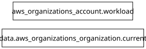

# Módulo: AWS Organizations (`modules/01-organization`)

Gestiona la cuenta miembro de Workload (`aws_organizations_account`) dentro del AWS Organization del laboratorio, o reutiliza una cuenta existente, configurando el rol de administración cruzada `OrganizationAccountAccessRole`.

---

## Requirements

| Name | Version |
|------|---------|
|  [terraform](#requirement\_terraform) | >= 1.6.0 |
|  [aws](#requirement\_aws) | >= 5.0 |

## Providers

| Name | Version |
|------|---------|
|  [aws](#provider\_aws) | >= 5.0 |

## Modules

No modules.

## Resources

| Name | Type |
|------|------|
| [aws_organizations_account.workload](https://registry.terraform.io/providers/hashicorp/aws/latest/docs/resources/organizations_account) | resource |
| [aws_organizations_organization.current](https://registry.terraform.io/providers/hashicorp/aws/latest/docs/data-sources/organizations_organization) | data source |

## Inputs

| Name | Description | Type | Default | Required |
|------|-------------|------|---------|:--------:|
|  [close\_on\_deletion](#input\_close\_on\_deletion) | Whether to close the AWS member account on terraform destroy. | `bool` | `false` | no |
|  [create\_workload\_account](#input\_create\_workload\_account) | Whether to create a new AWS Organizations member account for the Workload environment. Set to false if reusing an existing member account. | `bool` | `true` | no |
|  [existing\_workload\_account\_id](#input\_existing\_workload\_account\_id) | Existing AWS Account ID for the Workload environment when create\_workload\_account = false. | `string` | `""` | no |
|  [organization\_access\_role\_name](#input\_organization\_access\_role\_name) | IAM role name created in the member account for cross-account administration from the Management account. | `string` | `"OrganizationAccountAccessRole"` | no |
|  [workload\_account\_email](#input\_workload\_account\_email) | Unique root email address for the Workload AWS member account (e.g., aws-workload@midominio.com). | `string` | n/a | yes |
|  [workload\_account\_name](#input\_workload\_account\_name) | Friendly name for the Workload AWS member account. | `string` | `"claude-gateway-workload"` | no |

## Outputs

| Name | Description |
|------|-------------|
|  [organization\_access\_role\_arn](#output\_organization\_access\_role\_arn) | Cross-account IAM role ARN used by Terraform to provision resources in the Workload account. |
|  [workload\_account\_arn](#output\_workload\_account\_arn) | The ARN of the Workload account (if created via AWS Organizations). |
|  [workload\_account\_id](#output\_workload\_account\_id) | The 12-digit AWS Account ID of the Workload account. |

## Diagram

