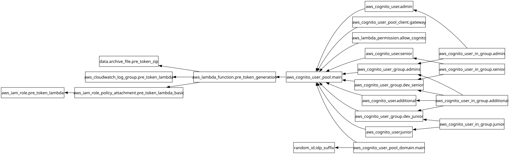

# Módulo: Identidad y Autenticación OIDC (`modules/02-identity-cognito`)

Configura el User Pool de Amazon Cognito en la Cuenta de Identidad (Cuenta A), los grupos de usuarios (`claude-gateway-admins`, `DevSenior`, `DevJunior`), los usuarios iniciales del laboratorio y la función Lambda Pre-Token Generation en Python encargada de inyectar el claim `groups` en el ID Token JWT para el Claude Apps Gateway.

---

## Requirements

| Name | Version |
|------|---------|
|  [terraform](#requirement\_terraform) | >= 1.6.0 |
|  [archive](#requirement\_archive) | ~> 2.4 |
|  [aws](#requirement\_aws) | >= 5.0 |
|  [random](#requirement\_random) | ~> 3.6 |

## Providers

| Name | Version |
|------|---------|
|  [archive](#provider\_archive) | ~> 2.4 |
|  [aws](#provider\_aws) | >= 5.0 |
|  [random](#provider\_random) | ~> 3.6 |

## Modules

No modules.

## Resources

| Name | Type |
|------|------|
| [aws_cloudwatch_log_group.pre_token_lambda](https://registry.terraform.io/providers/hashicorp/aws/latest/docs/resources/cloudwatch_log_group) | resource |
| [aws_cognito_user.additional](https://registry.terraform.io/providers/hashicorp/aws/latest/docs/resources/cognito_user) | resource |
| [aws_cognito_user.admin](https://registry.terraform.io/providers/hashicorp/aws/latest/docs/resources/cognito_user) | resource |
| [aws_cognito_user.junior](https://registry.terraform.io/providers/hashicorp/aws/latest/docs/resources/cognito_user) | resource |
| [aws_cognito_user.senior](https://registry.terraform.io/providers/hashicorp/aws/latest/docs/resources/cognito_user) | resource |
| [aws_cognito_user_group.admins](https://registry.terraform.io/providers/hashicorp/aws/latest/docs/resources/cognito_user_group) | resource |
| [aws_cognito_user_group.dev_junior](https://registry.terraform.io/providers/hashicorp/aws/latest/docs/resources/cognito_user_group) | resource |
| [aws_cognito_user_group.dev_senior](https://registry.terraform.io/providers/hashicorp/aws/latest/docs/resources/cognito_user_group) | resource |
| [aws_cognito_user_in_group.additional](https://registry.terraform.io/providers/hashicorp/aws/latest/docs/resources/cognito_user_in_group) | resource |
| [aws_cognito_user_in_group.admin](https://registry.terraform.io/providers/hashicorp/aws/latest/docs/resources/cognito_user_in_group) | resource |
| [aws_cognito_user_in_group.junior](https://registry.terraform.io/providers/hashicorp/aws/latest/docs/resources/cognito_user_in_group) | resource |
| [aws_cognito_user_in_group.senior](https://registry.terraform.io/providers/hashicorp/aws/latest/docs/resources/cognito_user_in_group) | resource |
| [aws_cognito_user_pool.main](https://registry.terraform.io/providers/hashicorp/aws/latest/docs/resources/cognito_user_pool) | resource |
| [aws_cognito_user_pool_client.gateway](https://registry.terraform.io/providers/hashicorp/aws/latest/docs/resources/cognito_user_pool_client) | resource |
| [aws_cognito_user_pool_domain.main](https://registry.terraform.io/providers/hashicorp/aws/latest/docs/resources/cognito_user_pool_domain) | resource |
| [aws_iam_role.pre_token_lambda](https://registry.terraform.io/providers/hashicorp/aws/latest/docs/resources/iam_role) | resource |
| [aws_iam_role_policy_attachment.pre_token_lambda_basic](https://registry.terraform.io/providers/hashicorp/aws/latest/docs/resources/iam_role_policy_attachment) | resource |
| [aws_lambda_function.pre_token_generation](https://registry.terraform.io/providers/hashicorp/aws/latest/docs/resources/lambda_function) | resource |
| [aws_lambda_permission.allow_cognito](https://registry.terraform.io/providers/hashicorp/aws/latest/docs/resources/lambda_permission) | resource |
| [random_id.idp_suffix](https://registry.terraform.io/providers/hashicorp/random/latest/docs/resources/id) | resource |
| [archive_file.pre_token_zip](https://registry.terraform.io/providers/hashicorp/archive/latest/docs/data-sources/file) | data source |

## Inputs

| Name | Description | Type | Default | Required |
|------|-------------|------|---------|:--------:|
|  [additional\_users](#input\_additional\_users) | Additional Cognito users to create and assign to groups (map of key => { email, group }). | <pre>map(object({     email = string     group = string   }))</pre> | `{}` | no |
|  [admin\_user\_email](#input\_admin\_user\_email) | Email for the platform administrator user in claude-gateway-admins. | `string` | `"admin@midominio.com"` | no |
|  [aws\_region](#input\_aws\_region) | AWS region where the Cognito User Pool is deployed. | `string` | `"eu-west-1"` | no |
|  [callback\_urls](#input\_callback\_urls) | Allowed OIDC OAuth 2.0 callback URLs for the Claude Apps Gateway. | `list(string)` | <pre>[   "https://aidevtool.midominio.com/oauth/callback",   "https://dev.midominio.com/oauth/callback",   "http://localhost:8080/oauth/callback" ]</pre> | no |
|  [domain\_name](#input\_domain\_name) | Primary domain name for user email addresses and lab URLs. | `string` | `"midominio.com"` | no |
|  [initial\_user\_password](#input\_initial\_user\_password) | Initial password assigned to seeded Cognito lab users. | `string` | n/a | yes |
|  [junior\_user\_email](#input\_junior\_user\_email) | Email for the junior developer user in DevJunior ($5/month quota). | `string` | `"junior@midominio.com"` | no |
|  [lambda\_runtime](#input\_lambda\_runtime) | AWS Lambda Python runtime version for the Pre-Token Generation trigger. | `string` | `"python3.14"` | no |
|  [logout\_urls](#input\_logout\_urls) | Allowed OIDC OAuth 2.0 sign-out URLs for the Claude Apps Gateway. | `list(string)` | <pre>[   "https://aidevtool.midominio.com",   "https://dev.midominio.com",   "http://localhost:8080" ]</pre> | no |
|  [project\_name](#input\_project\_name) | Project name prefix used for naming Cognito and IAM resources. | `string` | n/a | yes |
|  [senior\_user\_email](#input\_senior\_user\_email) | Email for the senior developer user in DevSenior ($10/month quota). | `string` | `"senior@midominio.com"` | no |

## Outputs

| Name | Description |
|------|-------------|
|  [admin\_group\_name](#output\_admin\_group\_name) | Name of the Cognito group for gateway administrators. |
|  [client\_id](#output\_client\_id) | The OIDC App Client ID for the Claude Apps Gateway. |
|  [client\_secret](#output\_client\_secret) | The OIDC App Client Secret for the Claude Apps Gateway. |
|  [hosted\_ui\_url](#output\_hosted\_ui\_url) | The Hosted UI base URL for the Cognito User Pool. |
|  [issuer\_url](#output\_issuer\_url) | The OIDC Issuer URL of the Cognito User Pool. |
|  [junior\_group\_name](#output\_junior\_group\_name) | Name of the Cognito group for Junior Developers ($5/month quota). |
|  [provisioned\_users](#output\_provisioned\_users) | Summary of provisioned Cognito users and their assigned groups. |
|  [senior\_group\_name](#output\_senior\_group\_name) | Name of the Cognito group for Senior Developers ($10/month quota). |
|  [user\_pool\_arn](#output\_user\_pool\_arn) | The ARN of the Cognito User Pool. |
|  [user\_pool\_id](#output\_user\_pool\_id) | The ID of the Cognito User Pool. |

## Diagram

