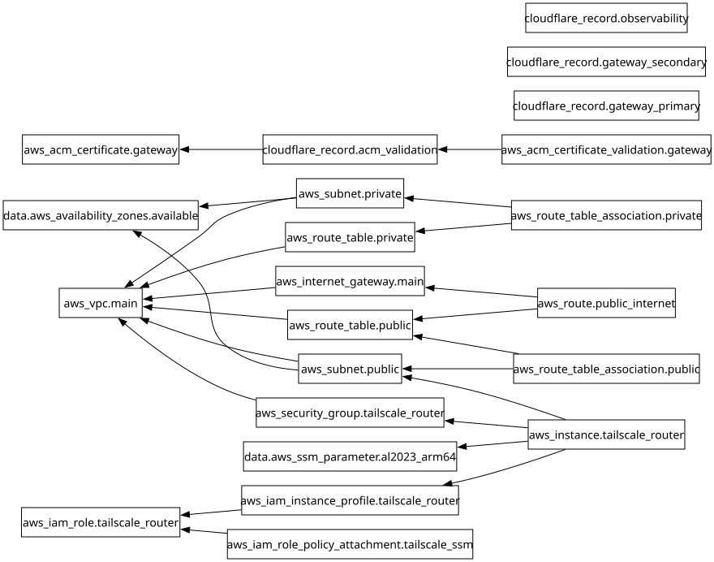

# Módulo: Redes, DNS y Acceso Seguro (`modules/03-networking-dns`)

Despliega la VPC privada `10.20.0.0/16` con subredes públicas y privadas aisladas (con coste $0 en NAT Gateways), el túnel WireGuard mediante Tailscale Subnet Router en EC2 AL2023 (`t4g.micro`), el certificado SSL/TLS en AWS ACM y los registros DNS privados en Cloudflare apuntando al Balanceador de Carga Interno (ALB).

---

## Requirements

| Name | Version |
|------|---------|
|  [terraform](#requirement\_terraform) | >= 1.6.0 |
|  [aws](#requirement\_aws) | >= 5.0 |
|  [cloudflare](#requirement\_cloudflare) | ~> 4.0 |

## Providers

| Name | Version |
|------|---------|
|  [aws](#provider\_aws) | >= 5.0 |
|  [cloudflare](#provider\_cloudflare) | ~> 4.0 |

## Modules

No modules.

## Resources

| Name | Type |
|------|------|
| [aws_acm_certificate.gateway](https://registry.terraform.io/providers/hashicorp/aws/latest/docs/resources/acm_certificate) | resource |
| [aws_acm_certificate_validation.gateway](https://registry.terraform.io/providers/hashicorp/aws/latest/docs/resources/acm_certificate_validation) | resource |
| [aws_iam_instance_profile.tailscale_router](https://registry.terraform.io/providers/hashicorp/aws/latest/docs/resources/iam_instance_profile) | resource |
| [aws_iam_role.tailscale_router](https://registry.terraform.io/providers/hashicorp/aws/latest/docs/resources/iam_role) | resource |
| [aws_iam_role_policy_attachment.tailscale_ssm](https://registry.terraform.io/providers/hashicorp/aws/latest/docs/resources/iam_role_policy_attachment) | resource |
| [aws_instance.tailscale_router](https://registry.terraform.io/providers/hashicorp/aws/latest/docs/resources/instance) | resource |
| [aws_internet_gateway.main](https://registry.terraform.io/providers/hashicorp/aws/latest/docs/resources/internet_gateway) | resource |
| [aws_route.public_internet](https://registry.terraform.io/providers/hashicorp/aws/latest/docs/resources/route) | resource |
| [aws_route_table.private](https://registry.terraform.io/providers/hashicorp/aws/latest/docs/resources/route_table) | resource |
| [aws_route_table.public](https://registry.terraform.io/providers/hashicorp/aws/latest/docs/resources/route_table) | resource |
| [aws_route_table_association.private](https://registry.terraform.io/providers/hashicorp/aws/latest/docs/resources/route_table_association) | resource |
| [aws_route_table_association.public](https://registry.terraform.io/providers/hashicorp/aws/latest/docs/resources/route_table_association) | resource |
| [aws_security_group.tailscale_router](https://registry.terraform.io/providers/hashicorp/aws/latest/docs/resources/security_group) | resource |
| [aws_subnet.private](https://registry.terraform.io/providers/hashicorp/aws/latest/docs/resources/subnet) | resource |
| [aws_subnet.public](https://registry.terraform.io/providers/hashicorp/aws/latest/docs/resources/subnet) | resource |
| [aws_vpc.main](https://registry.terraform.io/providers/hashicorp/aws/latest/docs/resources/vpc) | resource |
| [cloudflare_record.acm_validation](https://registry.terraform.io/providers/cloudflare/cloudflare/latest/docs/resources/record) | resource |
| [cloudflare_record.gateway_primary](https://registry.terraform.io/providers/cloudflare/cloudflare/latest/docs/resources/record) | resource |
| [cloudflare_record.gateway_secondary](https://registry.terraform.io/providers/cloudflare/cloudflare/latest/docs/resources/record) | resource |
| [cloudflare_record.observability](https://registry.terraform.io/providers/cloudflare/cloudflare/latest/docs/resources/record) | resource |
| [aws_availability_zones.available](https://registry.terraform.io/providers/hashicorp/aws/latest/docs/data-sources/availability_zones) | data source |
| [aws_ssm_parameter.al2023_arm64](https://registry.terraform.io/providers/hashicorp/aws/latest/docs/data-sources/ssm_parameter) | data source |

## Inputs

| Name | Description | Type | Default | Required |
|------|-------------|------|---------|:--------:|
|  [cloudflare\_zone\_id](#input\_cloudflare\_zone\_id) | Zone ID de Cloudflare para el dominio base | `string` | n/a | yes |
|  [create\_gateway\_dns\_records](#input\_create\_gateway\_dns\_records) | Si es true, crea los registros CNAME de acceso privado en Cloudflare apuntando al ALB Interno | `bool` | `true` | no |
|  [domain\_name](#input\_domain\_name) | Dominio base gestionado en Cloudflare | `string` | `"midominio.com"` | no |
|  [internal\_alb\_dns\_name](#input\_internal\_alb\_dns\_name) | DNS name del ALB interno en la Cuenta B para apuntar los CNAME de Cloudflare | `string` | `""` | no |
|  [observability\_subdomain](#input\_observability\_subdomain) | Subdominio privado en Cloudflare para Grafana + Loki + Alertmanager (ej. eyes) | `string` | `"eyes"` | no |
|  [primary\_subdomain](#input\_primary\_subdomain) | Subdominio principal para el Gateway (ej. aidevtool) | `string` | `"aidevtool"` | no |
|  [private\_subnet\_cidrs](#input\_private\_subnet\_cidrs) | Lista de CIDRs para las 2 subredes privadas aisladas en distintas AZs | `list(string)` | <pre>[   "10.20.11.0/24",   "10.20.12.0/24" ]</pre> | no |
|  [project\_name](#input\_project\_name) | Nombre base del proyecto para etiquetado y recursos de red | `string` | n/a | yes |
|  [public\_subnet\_cidrs](#input\_public\_subnet\_cidrs) | Lista de CIDRs para las 2 subredes publicas en distintas AZs | `list(string)` | <pre>[   "10.20.1.0/24",   "10.20.2.0/24" ]</pre> | no |
|  [secondary\_subdomain](#input\_secondary\_subdomain) | Subdominio secundario SAN para el Gateway (ej. dev) | `string` | `"dev"` | no |
|  [tailscale\_auth\_key](#input\_tailscale\_auth\_key) | Auth Key efimera/reusable de Tailscale para registrar el Subnet Router automaticamente | `string` | n/a | yes |
|  [tailscale\_hostname](#input\_tailscale\_hostname) | Hostname del nodo Subnet Router en la red Tailscale | `string` | `"aws-claude-gateway-router"` | no |
|  [tailscale\_instance\_type](#input\_tailscale\_instance\_type) | Tipo de instancia EC2 ARM64 para el Tailscale Subnet Router (t4g.micro = 1 GB RAM) | `string` | `"t4g.micro"` | no |
|  [vpc\_cidr](#input\_vpc\_cidr) | Bloque CIDR principal de la VPC en la Cuenta B (Workload) | `string` | `"10.20.0.0/16"` | no |

## Outputs

| Name | Description |
|------|-------------|
|  [acm\_certificate\_arn](#output\_acm\_certificate\_arn) | ARN del certificado ACM validado para subdominios principal y secundario |
|  [gateway\_primary\_fqdn](#output\_gateway\_primary\_fqdn) | FQDN principal del Gateway |
|  [gateway\_secondary\_fqdn](#output\_gateway\_secondary\_fqdn) | FQDN secundario (SAN) del Gateway |
|  [observability\_fqdn](#output\_observability\_fqdn) | FQDN privado de Grafana + Loki + Alertmanager (eyes) |
|  [private\_subnet\_cidrs](#output\_private\_subnet\_cidrs) | Bloques CIDR de las subredes privadas aisladas |
|  [private\_subnet\_ids](#output\_private\_subnet\_ids) | IDs de las 2 subredes privadas aisladas |
|  [public\_subnet\_ids](#output\_public\_subnet\_ids) | IDs de las 2 subredes publicas |
|  [tailscale\_router\_instance\_id](#output\_tailscale\_router\_instance\_id) | ID de la instancia EC2 del Tailscale Subnet Router |
|  [tailscale\_router\_private\_ip](#output\_tailscale\_router\_private\_ip) | IP privada del Tailscale Subnet Router |
|  [tailscale\_router\_public\_ip](#output\_tailscale\_router\_public\_ip) | IP publica de salida del Tailscale Subnet Router |
|  [tailscale\_router\_security\_group\_id](#output\_tailscale\_router\_security\_group\_id) | ID del Security Group del Tailscale Subnet Router |
|  [vpc\_cidr](#output\_vpc\_cidr) | Bloque CIDR de la VPC |
|  [vpc\_id](#output\_vpc\_id) | ID de la VPC en la Cuenta B (Workload) |

## Diagram

