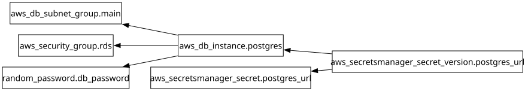

# Módulo: Base de Datos y Secretos (`modules/04-database`)

Aprovisiona la instancia de Amazon RDS PostgreSQL 16 (`db.t4g.micro`) en subredes privadas con coste optimizado para el laboratorio, junto con los grupos de subredes, grupos de seguridad y el secreto en AWS Secrets Manager con la URL de conexión cifrada.

---

## Requirements

| Name | Version |
|------|---------|
|  [terraform](#requirement\_terraform) | >= 1.6.0 |
|  [aws](#requirement\_aws) | >= 5.0 |
|  [random](#requirement\_random) | ~> 3.6 |

## Providers

| Name | Version |
|------|---------|
|  [aws](#provider\_aws) | >= 5.0 |
|  [random](#provider\_random) | ~> 3.6 |

## Modules

No modules.

## Resources

| Name | Type |
|------|------|
| [aws_db_instance.postgres](https://registry.terraform.io/providers/hashicorp/aws/latest/docs/resources/db_instance) | resource |
| [aws_db_subnet_group.main](https://registry.terraform.io/providers/hashicorp/aws/latest/docs/resources/db_subnet_group) | resource |
| [aws_secretsmanager_secret.postgres_url](https://registry.terraform.io/providers/hashicorp/aws/latest/docs/resources/secretsmanager_secret) | resource |
| [aws_secretsmanager_secret_version.postgres_url](https://registry.terraform.io/providers/hashicorp/aws/latest/docs/resources/secretsmanager_secret_version) | resource |
| [aws_security_group.rds](https://registry.terraform.io/providers/hashicorp/aws/latest/docs/resources/security_group) | resource |
| [random_password.db_password](https://registry.terraform.io/providers/hashicorp/random/latest/docs/resources/password) | resource |

## Inputs

| Name | Description | Type | Default | Required |
|------|-------------|------|---------|:--------:|
|  [db\_engine\_version](#input\_db\_engine\_version) | Version del motor PostgreSQL en RDS | `string` | `"16"` | no |
|  [db\_instance\_class](#input\_db\_instance\_class) | Clase de instancia RDS (db.t4g.micro por defecto para laboratorio) | `string` | `"db.t4g.micro"` | no |
|  [db\_name](#input\_db\_name) | Nombre de la base de datos PostgreSQL para el Gateway | `string` | `"claudegateway"` | no |
|  [db\_username](#input\_db\_username) | Usuario maestro de la instancia RDS PostgreSQL | `string` | `"gwadmin"` | no |
|  [ecs\_tasks\_security\_group\_id](#input\_ecs\_tasks\_security\_group\_id) | ID del Security Group de las tareas ECS Fargate autorizadas a conectar al puerto 5432 | `string` | n/a | yes |
|  [private\_subnet\_ids](#input\_private\_subnet\_ids) | Lista de IDs de subredes privadas aisladas para el DB Subnet Group | `list(string)` | n/a | yes |
|  [project\_name](#input\_project\_name) | Nombre base del proyecto para etiquetado y recursos de base de datos | `string` | n/a | yes |
|  [tailscale\_router\_security\_group\_id](#input\_tailscale\_router\_security\_group\_id) | ID del Security Group del Tailscale Subnet Router para administracion privada opcional | `string` | n/a | yes |
|  [vpc\_id](#input\_vpc\_id) | ID de la VPC en la Cuenta B (Workload) | `string` | n/a | yes |

## Outputs

| Name | Description |
|------|-------------|
|  [db\_address](#output\_db\_address) | Hostname DNS privado de la instancia RDS PostgreSQL |
|  [db\_endpoint](#output\_db\_endpoint) | Endpoint de conexion (host:port) de RDS PostgreSQL |
|  [db\_instance\_id](#output\_db\_instance\_id) | Identificador de la instancia RDS PostgreSQL |
|  [db\_name](#output\_db\_name) | Nombre de la base de datos creada |
|  [db\_port](#output\_db\_port) | Puerto de la instancia RDS PostgreSQL |
|  [postgres\_connection\_url](#output\_postgres\_connection\_url) | Cadena de conexion completa PostgreSQL para el Gateway y el contenedor de seed |
|  [postgres\_url\_secret\_arn](#output\_postgres\_url\_secret\_arn) | ARN del secreto en Secrets Manager con la URL de conexion PostgreSQL |
|  [rds\_security\_group\_id](#output\_rds\_security\_group\_id) | ID del Security Group de RDS PostgreSQL |

## Diagram

