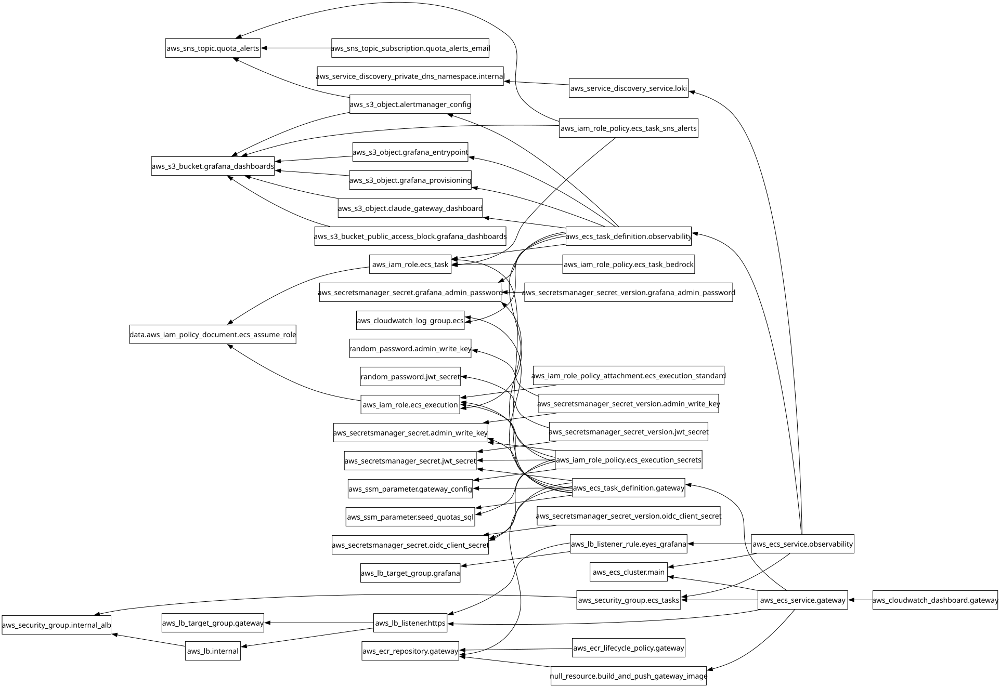

# Módulo: Claude Apps Gateway en ECS Fargate y Observabilidad (`modules/05-gateway-ecs`)

Despliega el servicio principal de Claude Apps Gateway sobre Amazon ECS Fargate y Application Load Balancer (ALB) Interno con terminación TLS, el contenedor inicial de seeding de cuotas en PostgreSQL, el proxy transparente para inspección de prompts hacia Loki, y el stack de observabilidad privado (Grafana, Loki, Alertmanager con alertas SNS al 80% de consumo y Dashboard en CloudWatch).

`aws_s3_bucket.grafana_dashboards` almacena también `gateway/gateway.yaml` y `gateway/seed_quotas.sql`. El contenedor `gateway-config-sync` descarga ambos objetos a un volumen compartido antes de ejecutar el SQL y arrancar el Gateway; sus credenciales continúan en Secrets Manager.

---

## Requirements

| Name | Version |
|------|---------|
|  [terraform](#requirement\_terraform) | >= 1.6.0 |
|  [aws](#requirement\_aws) | >= 5.0 |
|  [null](#requirement\_null) | ~> 3.2 |
|  [random](#requirement\_random) | ~> 3.6 |

## Providers

| Name | Version |
|------|---------|
|  [aws](#provider\_aws) | >= 5.0 |
|  [null](#provider\_null) | ~> 3.2 |
|  [random](#provider\_random) | ~> 3.6 |

## Modules

No modules.

## Resources

| Name | Type |
|------|------|
| [aws_cloudwatch_dashboard.gateway](https://registry.terraform.io/providers/hashicorp/aws/latest/docs/resources/cloudwatch_dashboard) | resource |
| [aws_cloudwatch_log_group.ecs](https://registry.terraform.io/providers/hashicorp/aws/latest/docs/resources/cloudwatch_log_group) | resource |
| [aws_ecr_lifecycle_policy.gateway](https://registry.terraform.io/providers/hashicorp/aws/latest/docs/resources/ecr_lifecycle_policy) | resource |
| [aws_ecr_repository.gateway](https://registry.terraform.io/providers/hashicorp/aws/latest/docs/resources/ecr_repository) | resource |
| [aws_ecs_cluster.main](https://registry.terraform.io/providers/hashicorp/aws/latest/docs/resources/ecs_cluster) | resource |
| [aws_ecs_service.gateway](https://registry.terraform.io/providers/hashicorp/aws/latest/docs/resources/ecs_service) | resource |
| [aws_ecs_service.observability](https://registry.terraform.io/providers/hashicorp/aws/latest/docs/resources/ecs_service) | resource |
| [aws_ecs_task_definition.gateway](https://registry.terraform.io/providers/hashicorp/aws/latest/docs/resources/ecs_task_definition) | resource |
| [aws_ecs_task_definition.observability](https://registry.terraform.io/providers/hashicorp/aws/latest/docs/resources/ecs_task_definition) | resource |
| [aws_iam_role.ecs_execution](https://registry.terraform.io/providers/hashicorp/aws/latest/docs/resources/iam_role) | resource |
| [aws_iam_role.ecs_task](https://registry.terraform.io/providers/hashicorp/aws/latest/docs/resources/iam_role) | resource |
| [aws_iam_role_policy.ecs_execution_secrets](https://registry.terraform.io/providers/hashicorp/aws/latest/docs/resources/iam_role_policy) | resource |
| [aws_iam_role_policy.ecs_task_bedrock](https://registry.terraform.io/providers/hashicorp/aws/latest/docs/resources/iam_role_policy) | resource |
| [aws_iam_role_policy.ecs_task_sns_alerts](https://registry.terraform.io/providers/hashicorp/aws/latest/docs/resources/iam_role_policy) | resource |
| [aws_iam_role_policy_attachment.ecs_execution_standard](https://registry.terraform.io/providers/hashicorp/aws/latest/docs/resources/iam_role_policy_attachment) | resource |
| [aws_lb.internal](https://registry.terraform.io/providers/hashicorp/aws/latest/docs/resources/lb) | resource |
| [aws_lb_listener.https](https://registry.terraform.io/providers/hashicorp/aws/latest/docs/resources/lb_listener) | resource |
| [aws_lb_listener_rule.eyes_grafana](https://registry.terraform.io/providers/hashicorp/aws/latest/docs/resources/lb_listener_rule) | resource |
| [aws_lb_target_group.gateway](https://registry.terraform.io/providers/hashicorp/aws/latest/docs/resources/lb_target_group) | resource |
| [aws_lb_target_group.grafana](https://registry.terraform.io/providers/hashicorp/aws/latest/docs/resources/lb_target_group) | resource |
| [aws_s3_bucket.grafana_dashboards](https://registry.terraform.io/providers/hashicorp/aws/latest/docs/resources/s3_bucket) | resource |
| [aws_s3_bucket_public_access_block.grafana_dashboards](https://registry.terraform.io/providers/hashicorp/aws/latest/docs/resources/s3_bucket_public_access_block) | resource |
| [aws_s3_object.alertmanager_config](https://registry.terraform.io/providers/hashicorp/aws/latest/docs/resources/s3_object) | resource |
| [aws_s3_object.claude_gateway_dashboard](https://registry.terraform.io/providers/hashicorp/aws/latest/docs/resources/s3_object) | resource |
| [aws_s3_object.grafana_entrypoint](https://registry.terraform.io/providers/hashicorp/aws/latest/docs/resources/s3_object) | resource |
| [aws_s3_object.grafana_provisioning](https://registry.terraform.io/providers/hashicorp/aws/latest/docs/resources/s3_object) | resource |
| [aws_s3_object.gateway_config](https://registry.terraform.io/providers/hashicorp/aws/latest/docs/resources/s3_object) | resource |
| [aws_s3_object.seed_quotas_sql](https://registry.terraform.io/providers/hashicorp/aws/latest/docs/resources/s3_object) | resource |
| [aws_secretsmanager_secret.admin_write_key](https://registry.terraform.io/providers/hashicorp/aws/latest/docs/resources/secretsmanager_secret) | resource |
| [aws_secretsmanager_secret.grafana_admin_password](https://registry.terraform.io/providers/hashicorp/aws/latest/docs/resources/secretsmanager_secret) | resource |
| [aws_secretsmanager_secret.jwt_secret](https://registry.terraform.io/providers/hashicorp/aws/latest/docs/resources/secretsmanager_secret) | resource |
| [aws_secretsmanager_secret.oidc_client_secret](https://registry.terraform.io/providers/hashicorp/aws/latest/docs/resources/secretsmanager_secret) | resource |
| [aws_secretsmanager_secret_version.admin_write_key](https://registry.terraform.io/providers/hashicorp/aws/latest/docs/resources/secretsmanager_secret_version) | resource |
| [aws_secretsmanager_secret_version.grafana_admin_password](https://registry.terraform.io/providers/hashicorp/aws/latest/docs/resources/secretsmanager_secret_version) | resource |
| [aws_secretsmanager_secret_version.jwt_secret](https://registry.terraform.io/providers/hashicorp/aws/latest/docs/resources/secretsmanager_secret_version) | resource |
| [aws_secretsmanager_secret_version.oidc_client_secret](https://registry.terraform.io/providers/hashicorp/aws/latest/docs/resources/secretsmanager_secret_version) | resource |
| [aws_security_group.ecs_tasks](https://registry.terraform.io/providers/hashicorp/aws/latest/docs/resources/security_group) | resource |
| [aws_security_group.internal_alb](https://registry.terraform.io/providers/hashicorp/aws/latest/docs/resources/security_group) | resource |
| [aws_service_discovery_private_dns_namespace.internal](https://registry.terraform.io/providers/hashicorp/aws/latest/docs/resources/service_discovery_private_dns_namespace) | resource |
| [aws_service_discovery_service.loki](https://registry.terraform.io/providers/hashicorp/aws/latest/docs/resources/service_discovery_service) | resource |
| [aws_sns_topic.quota_alerts](https://registry.terraform.io/providers/hashicorp/aws/latest/docs/resources/sns_topic) | resource |
| [aws_sns_topic_subscription.quota_alerts_email](https://registry.terraform.io/providers/hashicorp/aws/latest/docs/resources/sns_topic_subscription) | resource |
| [null_resource.build_and_push_gateway_image](https://registry.terraform.io/providers/hashicorp/null/latest/docs/resources/resource) | resource |
| [random_password.admin_write_key](https://registry.terraform.io/providers/hashicorp/random/latest/docs/resources/password) | resource |
| [random_password.jwt_secret](https://registry.terraform.io/providers/hashicorp/random/latest/docs/resources/password) | resource |
| [aws_iam_policy_document.ecs_assume_role](https://registry.terraform.io/providers/hashicorp/aws/latest/docs/data-sources/iam_policy_document) | data source |

## Inputs

| Name | Description | Type | Default | Required |
|------|-------------|------|---------|:--------:|
|  [acm\_certificate\_arn](#input\_acm\_certificate\_arn) | ARN del certificado ACM validado en Cloudflare para subdominios principal y secundario | `string` | n/a | yes |
|  [admin\_group\_name](#input\_admin\_group\_name) | Nombre del grupo OIDC de administradores del Gateway | `string` | `"claude-gateway-admins"` | no |
|  [alert\_email](#input\_alert\_email) | Correo electronico destino en Alertmanager/SNS para alertas cuando un usuario alcance el 80% de su cuota mensual | `string` | `"alertas@midominio.com"` | no |
|  [auto\_build\_gateway\_image](#input\_auto\_build\_gateway\_image) | Si es true, construye y sube automaticamente la imagen Docker del Claude Apps Gateway a ECR en la Cuenta B durante terraform apply usando docker/Dockerfile. | `bool` | `true` | no |
|  [aws\_region](#input\_aws\_region) | Region de AWS donde se despliega ECS Fargate y se invoca Amazon Bedrock | `string` | `"eu-west-1"` | no |
|  [claude\_binary\_version](#input\_claude\_binary\_version) | Version del binario oficial de Claude Code a empaquetar en la imagen Docker del Gateway (ej. 'latest' o '2.1.296'). | `string` | `"latest"` | no |
|  [cognito\_client\_id](#input\_cognito\_client\_id) | Client ID de la aplicacion OIDC en Amazon Cognito (Cuenta A) | `string` | n/a | yes |
|  [cognito\_client\_secret](#input\_cognito\_client\_secret) | Client Secret de la aplicacion OIDC en Amazon Cognito (Cuenta A) | `string` | n/a | yes |
|  [cognito\_issuer\_url](#input\_cognito\_issuer\_url) | URL del emisor OIDC del User Pool de Amazon Cognito en la Cuenta A | `string` | n/a | yes |
|  [gateway\_fqdn](#input\_gateway\_fqdn) | FQDN principal del Claude Apps Gateway (ej. aidevtool.midominio.com) | `string` | n/a | yes |
|  [gateway\_image\_uri](#input\_gateway\_image\_uri) | URI opcional de la imagen del contenedor del Claude Apps Gateway. Si es vacia, usa el ECR creado en este modulo | `string` | `""` | no |
|  [grafana\_admin\_password](#input\_grafana\_admin\_password) | Contrasena del usuario admin de Grafana en la URL privada de observabilidad | `string` | n/a | yes |
|  [junior\_group\_name](#input\_junior\_group\_name) | Nombre del grupo OIDC para desarrolladores Junior ($5/mes) | `string` | `"DevJunior"` | no |
|  [junior\_monthly\_limit\_usd](#input\_junior\_monthly\_limit\_usd) | Tope de gasto mensual en USD para el grupo DevJunior | `number` | `5` | no |
|  [observability\_fqdn](#input\_observability\_fqdn) | FQDN privado en Cloudflare para acceder a Grafana via Tailscale (ej. eyes.midominio.com) | `string` | n/a | yes |
|  [postgres\_url\_secret\_arn](#input\_postgres\_url\_secret\_arn) | ARN del secreto en Secrets Manager que almacena la URL de conexion a RDS PostgreSQL | `string` | n/a | yes |
|  [private\_subnet\_cidrs](#input\_private\_subnet\_cidrs) | Bloques CIDR de las subredes privadas para trusted\_proxies en gateway.yaml | `list(string)` | n/a | yes |
|  [private\_subnet\_ids](#input\_private\_subnet\_ids) | IDs de las subredes privadas aisladas para el ALB Interno | `list(string)` | n/a | yes |
|  [project\_name](#input\_project\_name) | Nombre base del proyecto para etiquetado y recursos de ECS, ALB e IAM | `string` | n/a | yes |
|  [public\_subnet\_ids](#input\_public\_subnet\_ids) | IDs de las subredes publicas para tareas ECS Fargate con assign\_public\_ip = true (Cero NAT Gateway) | `list(string)` | n/a | yes |
|  [senior\_group\_name](#input\_senior\_group\_name) | Nombre del grupo OIDC para desarrolladores Senior ($10/mes) | `string` | `"DevSenior"` | no |
|  [senior\_monthly\_limit\_usd](#input\_senior\_monthly\_limit\_usd) | Tope de gasto mensual en USD para el grupo DevSenior | `number` | `10` | no |
|  [tailscale\_router\_security\_group\_id](#input\_tailscale\_router\_security\_group\_id) | ID del Security Group del Tailscale Subnet Router autorizado a llegar al puerto 443 del ALB Interno | `string` | n/a | yes |
|  [vpc\_cidr](#input\_vpc\_cidr) | Bloque CIDR de la VPC en la Cuenta B | `string` | n/a | yes |
|  [vpc\_id](#input\_vpc\_id) | ID de la VPC en la Cuenta B (Workload) | `string` | n/a | yes |
|  [workload\_account\_id](#input\_workload\_account\_id) | ID de 12 digitos de la Cuenta B (Workload) donde reside el repositorio ECR | `string` | n/a | yes |
|  [workload\_assume\_role\_arn](#input\_workload\_assume\_role\_arn) | ARN del rol IAM en la Cuenta B que asume el script local de construccion Docker para autenticarse en ECR | `string` | `""` | no |

## Outputs

| Name | Description |
|------|-------------|
|  [alertmanager\_sns\_topic\_arn](#output\_alertmanager\_sns\_topic\_arn) | ARN del topico SNS en la Cuenta B para alertas por email (80% de cuota mensual) desde Alertmanager |
|  [cloudwatch\_dashboard\_name](#output\_cloudwatch\_dashboard\_name) | Nombre del CloudWatch Dashboard creado en la Cuenta B |
|  [ecr\_repository\_url](#output\_ecr\_repository\_url) | URL del repositorio ECR en la Cuenta B para subir la imagen del Claude Apps Gateway |
|  [ecs\_cluster\_name](#output\_ecs\_cluster\_name) | Nombre del cluster ECS Fargate en la Cuenta B |
|  [ecs\_service\_name](#output\_ecs\_service\_name) | Nombre del servicio ECS Fargate del Gateway |
|  [ecs\_tasks\_security\_group\_id](#output\_ecs\_tasks\_security\_group\_id) | ID del Security Group de las tareas ECS Fargate (usado por RDS para permitir 5432) |
|  [gateway\_config\_s3\_uri](#output\_gateway\_config\_s3\_uri) | URI S3 del archivo gateway.yaml renderizado |
|  [grafana\_dashboards\_s3\_bucket](#output\_grafana\_dashboards\_s3\_bucket) | Nombre del bucket S3 privado en la Cuenta B que almacena dashboards y configuracion |
|  [internal\_alb\_arn](#output\_internal\_alb\_arn) | ARN del Application Load Balancer Interno |
|  [internal\_alb\_dns\_name](#output\_internal\_alb\_dns\_name) | DNS name privado del Application Load Balancer Interno (destino de los CNAMEs en Cloudflare) |
|  [internal\_alb\_security\_group\_id](#output\_internal\_alb\_security\_group\_id) | ID del Security Group del ALB Interno |
|  [observability\_ecs\_service\_name](#output\_observability\_ecs\_service\_name) | Nombre del servicio ECS Fargate de observabilidad (Grafana + Loki + Alertmanager) |
|  [seed\_quotas\_s3\_uri](#output\_seed\_quotas\_s3\_uri) | URI S3 del script SQL de inicializacion de topes mensuales |

## Diagram

